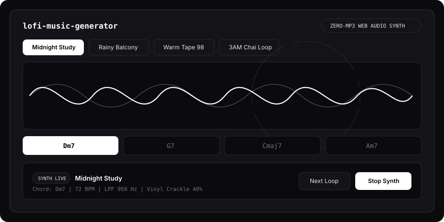

# lofi-music-generator


Zero-MP3 procedural Lo-Fi hip-hop & vinyl crackle synthesizer built purely with the browser Web Audio API + a reactive 60fps HTML5 `<canvas>` oscilloscope visualizer.

Wrote this because streaming 50MB background playlists while debugging code on flaky Wi-Fi felt silly when `AudioContext` can synthesize warm 7th chords, tape flutter, sub-bass, and dusty vinyl pops in ~200 lines of JS. Zero `.mp3` or `.wav` files anywhere in the repo.



## What this thing actually does

- **100% procedural Web Audio graph**: Blends sine + triangle oscillators with random cent detuning (`[-4.5, +4.5]` cents) for analog tape wow/flutter, routed through a warm resonant biquad lowpass filter (`950 Hz`, `Q = 1.2`).
- **Real-time vinyl dust & tape hiss**: Generates a 2-second looping `AudioBuffer` filled with soft white-noise hiss and stochastic vinyl crackle spikes passed through a `1400 Hz` bandpass filter.
- **4 built-in jazz/pentatonic progressions**: Switch live between `Midnight Study` (`Dm7 -> G7 -> Cmaj7 -> Am7`), `Rainy Balcony`, `Warm Tape 98`, and `3AM Chai Loop`, with sliders for lowpass cutoff, crackle density, BPM, and master gain.
- **Reactive `<canvas>` wave contour**: Taps an `AnalyserNode` (`getByteTimeDomainData`) to draw live waveforms over subtle obsidian glass contours.

## Run it in 60 seconds

```bash
git clone https://github.com/LevCodeLab/lofi-music-generator.git
cd lofi-music-generator
npm install
npm run dev
```

Open `http://localhost:5173`, click **Start Synth**, and tweak the lowpass filter or crackle slider live.

Run the DSP & chord voicing unit tests:

```bash
npm test
```

## Where to edit stuff

| File | What lives here |
| :--- | :--- |
| `src/services/ambientLoFiEngine.js` | `AmbientLoFiEngine` class, `CHORD_PRESETS` Hz tables, envelope scheduling, and vinyl buffer synthesis |
| `src/components/LiquidContourBackground.jsx` | 60fps `<canvas>` live oscilloscope + SVG contour backdrop |
| `src/components/AudioPlayer.jsx` | Persistent monochrome transport deck (Start/Stop, Mute, Next Loop) |
| `src/App.jsx` | Standalone synth studio page with live filter, crackle, BPM, and gain sliders |
| `test/engine.test.js` | Node unit tests for chord voicings, PCM crackle bounds, and synth state transitions |

## License

MIT License. Clone it, break it, ship it.
